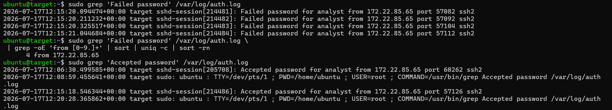
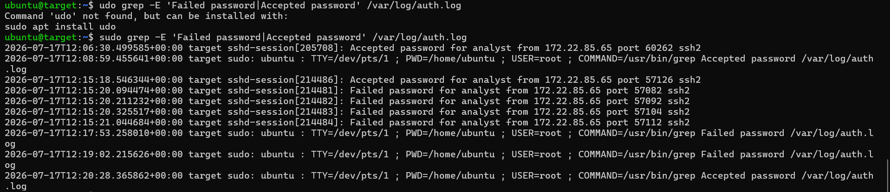

# SSH Brute-Force Investigation and Detection Design

A controlled training investigation using Linux SSH authentication logs. I manually correlated repeated failures with a successful login in an authorized simulation, documented the incident, and designed a Sigma correlation for the failed-login burst.

## What I did

- Built an isolated Ubuntu lab with Multipass and simulated password guessing against a disposable account.
- Investigated `/var/log/auth.log`, correlating source address, account, target and event times.
- Documented four failed attempts followed by one successful authentication in the existing report.
- Mapped the simulated behavior to MITRE ATT&CK T1110 and T1078.
- Wrote an incident report with proposed containment and recovery actions.
- Corrected the detection design and checked its structure and threshold behavior using explicitly synthetic fixtures.

## Evidence

These are the original uploaded screenshots, not newly generated evidence.

Read the [incident report](incident_report.md) for the recorded timeline and investigation limitations.

## Detection design and validation

[sigma.yml](sigma.yml) contains a base SSH-failure rule and an `event_count` correlation: **at least four failures within 60 seconds for the same target host, source address and account**. This deliberately low training threshold matches the report's four-failure example; it is not a production default.

The collection pipeline must populate `message`, `host`, `src_ip` and `username`. Raw text does not automatically supply the grouping fields. Backend field mappings, correlation support and window behavior must be tested before deployment.

The rule detects a failure burst. **It does not detect the subsequent successful login or automatically confirm compromise.** That step was performed manually in this project.

See [validation.md](validation.md) for parser checks, reproducible synthetic cases and the remaining live-SIEM acceptance work. Run `python validate_detection.py` after installing the pinned dependencies from [requirements-validation.txt](requirements-validation.txt).

## Analyst interpretation

In this authorized simulation, the known exercise context supports the account-compromise conclusion. Outside the lab, failed logins followed by success are a reason to investigate, not proof that an attacker guessed a password. Check whether the login was expected, whether the source is shared, and what the session did afterward.

## Honest scope

The original investigation was manual. Synthetic threshold tests and Sigma parsing do not prove that a deployed SIEM raised an alert. Live backend conversion, telemetry mapping, positive/negative replay and post-login investigation remain to be demonstrated.

The existing build-guide PDFs and video are historical learning materials. This README, `sigma.yml`, `incident_report.md` and `validation.md` describe the corrected portfolio; older guides may retain superseded paths or rule examples.

## References

- [Sigma correlation specification](https://sigmahq.io/sigma-specification/specification/sigma-correlation-rules-specification.html)
- [MITRE ATT&CK: Brute Force](https://attack.mitre.org/techniques/T1110/)
- [MITRE ATT&CK: Valid Accounts](https://attack.mitre.org/techniques/T1078/)
